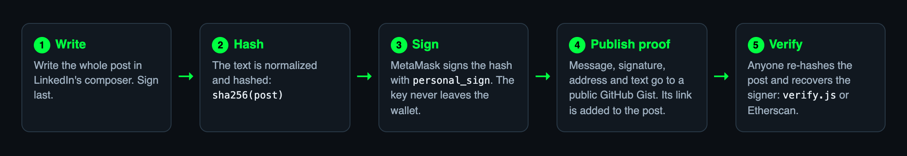
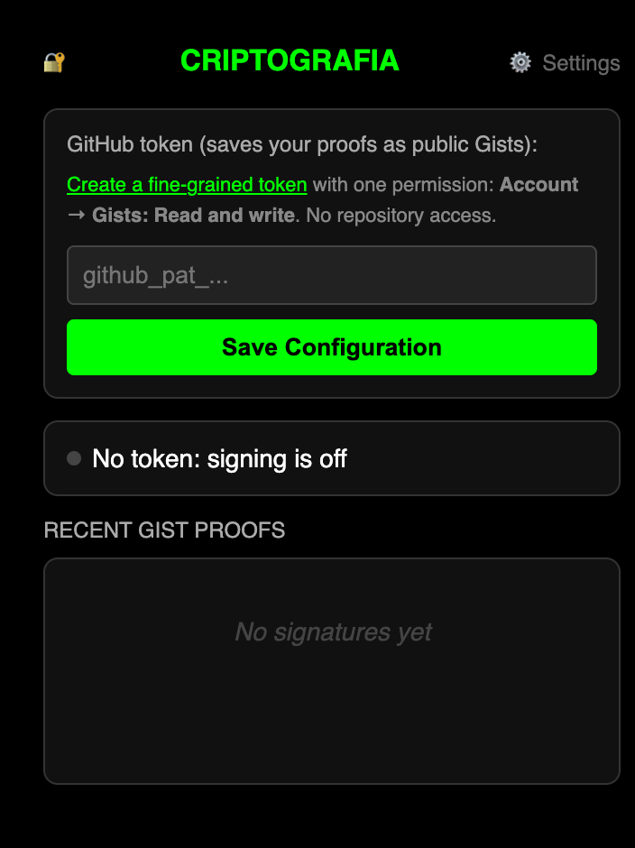
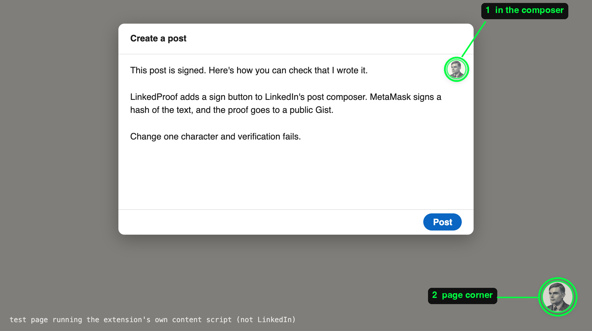
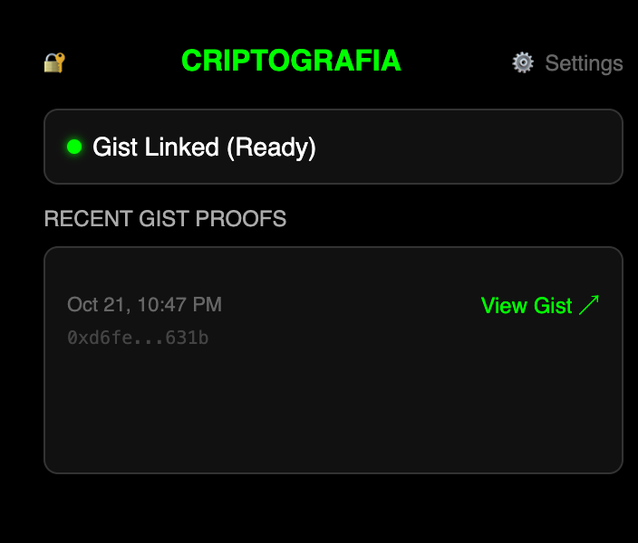
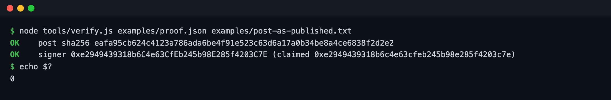
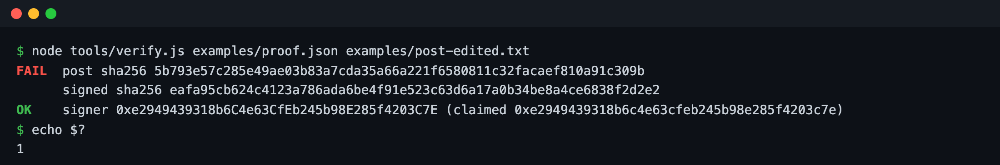

# LinkedProof

**Sign your LinkedIn posts with MetaMask. Anyone can check you wrote them.**

LinkedProof is a Chrome extension that adds a sign button to LinkedIn's post
composer. Your wallet signs a hash of the post, the proof goes to a public
GitHub Gist, and a short signature line with the Gist link is added to the
post. Change one word after signing and verification fails.



Why: impersonation and AI-written "quotes" are cheap now. A signature binds
this exact text to a key you control, and checking it needs no account and no
trust in this extension.

## Install

LinkedProof isn't in the Chrome Web Store, so you load it yourself. It takes
about two minutes. Works in Chrome, Brave and Edge.

1. **Get the code.** On this page click **Code → Download ZIP** and unzip it,
   or `git clone https://github.com/criptografia-app/LinkedProof`.
2. Open `chrome://extensions` (Brave: `brave://extensions`).
3. Turn on **Developer mode** (top right).
4. Click **Load unpacked** and select the `LinkedProof` folder (the one with
   `manifest.json` in it).
5. Pin it: puzzle-piece icon in the toolbar → pin **CRIPTOGRAFIA LinkedIn
   Signing**.
6. You need [MetaMask](https://metamask.io) installed and unlocked.

## Set up the GitHub token (once)

Proofs are saved as public Gists on your GitHub account, so the extension
needs a token that can create Gists, and nothing else.



1. Open [github.com/settings/personal-access-tokens/new](https://github.com/settings/personal-access-tokens/new)
   (a **fine-grained** token).
2. Name it `LinkedProof`, pick an expiry.
3. **Repository access: Public repositories** (read-only, the default) is fine.
   The extension never touches repositories.
4. **Account permissions → Gists → Read and write.** That's the only
   permission it needs.
5. Generate, copy the `github_pat_...` value.
6. Click the LinkedProof icon → **Settings**, paste it, **Save**.

Until a token is set the extension refuses to sign. It never adds a signature
line to a post unless the proof was actually saved.

<br clear="right">

## Sign a post

1. On LinkedIn click **Start a post** and write the **whole** post.
2. Click the round sign button (Alan Turing, green ring): the small one pinned
   to the top-right of the text box, or the bigger one in the bottom-right
   corner of the page. Both do the same thing.

   

   *Shown on a plain test page running the extension's own content script, so
   the screenshot doesn't need a LinkedIn login. On LinkedIn the buttons sit
   in the same places.*
3. MetaMask asks you to sign a short message: the post's SHA-256 hash, a
   timestamp and a random reference. Approve.
4. The extension saves the proof Gist and adds one line to the end of the post:

   ```
   🔐 Digitally Signed by CRIPTOGRAFIA [0x5f2c…](https://gist.github.com/you/…)
   ```

5. Publish.

**Sign last.** Any edit to the text after signing breaks verification.
Whitespace, blank lines and LinkedIn's hashtag markup don't: the text is
normalized before hashing (see [`src/normalize.js`](src/normalize.js)).



The popup lists your recent proofs with a link to each Gist.

## Verify a post

Anyone can do this. You need the post text and its proof Gist (the link in
the signature line).

### With the script

```bash
git clone https://github.com/criptografia-app/LinkedProof && cd LinkedProof
npm install                      # one dependency: ethers, for signer recovery
# copy the post from LinkedIn into post.txt, then:
node tools/verify.js https://gist.github.com/<user>/<id> post.txt
```

It re-hashes the post, compares it with the signed hash, and recovers the
address that signed it. Exit code 0 means both checks passed.

A post copied straight from LinkedIn, with its extra blank lines, `hashtag#`
markup and the signature line, still verifies:



Change one word and it fails, while the signature itself is still valid. It
just doesn't cover this text:



Both runs use [`examples/`](examples/): a sample post signed by a throwaway
key made by [`examples/make-example.js`](examples/make-example.js), so you can
try verification without a wallet or a network.

### Without installing anything

Open the proof Gist and paste its `address`, `message` and `signature` into
[etherscan.io/verifiedSignatures](https://etherscan.io/verifiedSignatures).
That checks the signature. To check it covers the post, compare the `sha256:`
line in the message with the SHA-256 of the normalized post text, or use the
script.

## Who signed it?

A valid signature proves that the holder of a key signed this exact text. It
doesn't prove who that is. The link to a person comes from the author
publishing their address somewhere they control: an ENS name, a profile, a
website.

My posts are signed by `marcomatos.eth`
(`0x4ad313f3C7e08707F163BAe7EaBF990039e61057`).

## What gets signed

```
LinkedIn post signature
sha256: <SHA-256 of the normalized post text>
Time: <ISO timestamp>
Ref: <random nonce>
```

signed with `personal_sign` (EIP-191). The Gist holds a JSON file with the
message, signature, address, timestamp, the normalized post text, its hash and
the normalization version.

## Permissions and privacy

| What | Why |
|------|-----|
| Runs on `linkedin.com` | To add the button and read the composer text when you click it |
| `storage` | Your GitHub token (Chrome sync storage) and a history of your last 50 proofs (local) |
| `api.github.com` | To create the proof Gist. The only network call the extension makes |

- Your key stays in MetaMask. The extension only asks it for a signature.
- The proof is **public**: the Gist contains the full post text and your
  address.
- The token sits in Chrome's sync storage, so it syncs to your other Chrome
  devices. Give it only the Gists permission and an expiry, and revoke it from
  GitHub settings if you stop using LinkedProof.
- No analytics, no server of ours.

## Troubleshooting

| Problem | Fix |
|---------|-----|
| No sign button | Refresh LinkedIn. The small button appears inside **Start a post**; the big one is always in the bottom-right corner |
| "add a GitHub token first" | Set the token in the popup (see setup above) |
| "Proof not saved: Bad credentials" | The token expired or lacks Gists read/write. Make a new one |
| "Nothing to sign yet" | The composer wasn't found or is empty. Write the post, then sign |
| MetaMask doesn't open | Unlock MetaMask. The extension finds it by name (EIP-6963), so another wallet owning `window.ethereum` (Brave Wallet) doesn't matter |
| Signature line copied, not inserted | Paste it (Ctrl/Cmd+V) at the end of the post |

## Limits

- LinkedIn changes its composer markup often. Finding the editor is the
  fragile part, not the cryptography.
- Text posts only. Images, documents and polls attached to a post are not
  covered by the signature.
- Not in the Chrome Web Store yet, so updates mean pulling the repo and
  clicking reload on `chrome://extensions`.

## Project layout

```
manifest.json          Chrome MV3 manifest
src/cripto_content.js  composer button, reads the post, inserts the signature line
src/cripto_page.js     talks to MetaMask (page context, EIP-6963)
src/background.js      saves the proof Gist
src/normalize.js       text normalization, shared with the verifier
src/popup.*            token setup and recent proofs
tools/verify.js        verifier
examples/              sample post and proof (throwaway key)
docs/                  images for this README
```

## License

MIT. See [LICENSE](LICENSE).
